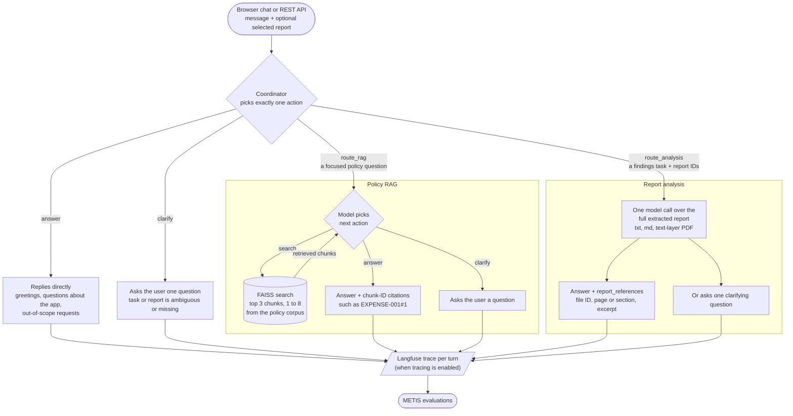

# Northstar Policy & Report Assistant

A small multi-agent assistant for a fictional company, Northstar Services, used
to demonstrate and regression-test METIS agent evaluation metrics.

> [!WARNING]
> **This is an experimental evaluation target, not a production-ready
> application.** Use synthetic or non-sensitive data only. The project has no
> availability, durability, or support SLA and must not be used to make or
> automate operational decisions.

## What it does

You can use the assistant through a web chat page or call it directly through a
REST API. It does two separate jobs, and each message uses only one of them:

| Route | Answers from | Example |
|---|---|---|
| **Policy Q&A** | The built-in Northstar policy documents only, with chunk citations | "What is the lodging limit for domestic travel?" |
| **Report analysis** | The report you upload only, with page or section references | "Summarise this report" or "What risks does it flag?" |

```text
                              ┌──▶ Policy Q&A ───────▶ Northstar policy documents
  your message ──▶ coordinator┤
                              └──▶ Report analysis ──▶ the report you selected

  One route per message. The two specialists never see each other's evidence.
```

A coordinator reads each message and decides how to handle it. It replies
itself (greetings, questions about the app, out-of-scope requests), asks a
clarifying question, or hands the message to exactly one specialist. The policy
specialist searches the policy documents and answers only from the passages it
retrieved. The report specialist reads the whole selected report and answers
only from it. Optional Langfuse instrumentation exports each turn as a trace.

### What it can't do

The two routes are independent, so no answer can draw on both the policy
documents and your report. Questions such as "Does this report's expense claim
comply with our policy?" or "Which policy covers the issue on page 3?" need both
sources. The assistant will answer only one half of them, or ask you to narrow
the question. Follow-up messages share the conversation history, but that does
not give one specialist access to the other's evidence. To compare a report
with policy, ask each question separately and compare the answers yourself.

### How a turn flows

Each message goes to the coordinator, which sees the user's text, the public
conversation history, and any report the user has selected. It makes one
structured decision per turn and picks exactly one of four actions.



A message is routed by the task it asks for, not by whether a file is attached,
so a file that merely contains a policy question still goes to policy RAG. The
coordinator never routes to more than one specialist in a turn, and it treats
report text as untrusted data, so instructions embedded in a report are not
followed.

**Policy RAG** answers only from retrieved policy text, and it is multi-step
and multi-turn. Within one user turn it loops: on each step it decides whether
to search, ask the user a question, or answer, and it can answer without
searching for greetings and questions about its own role. It also receives the
public conversation history, so a reply to its clarifying question in the next
turn is read with that earlier context. The loop is capped (by default four
model calls and two searches), and every cited chunk ID is checked against what
was actually retrieved, with mismatches flagged. Uploaded reports never enter
its index.

**Report analysis** reads the whole selected report in one model call and
answers only from it, separating what the report says from its own
interpretation. Each reference it returns is checked against the real page or
section, and a locator or excerpt that does not match is flagged as a
validation finding. By default a report may be up to 5 MiB, 50 PDF pages, and
100,000 extracted characters, and scanned PDFs are not supported.

## Quick start

You need Python 3.11+, [uv](https://docs.astral.sh/uv/), and Make (or Docker
with Compose; see [Running the application](docs/running.md)).

```bash
make install
TOYAPP_GENERATION_PROVIDER=deterministic TOYAPP_LANGFUSE_ENABLED=false make run
```

Then open <http://127.0.0.1:8000/>. This uses a deterministic model stand-in, so
it needs no API keys and costs nothing. The first run downloads the embedding
model. For a live model and Langfuse tracing, see
[Configuration](docs/configuration.md).

## Documentation

| Guide | Contents |
|---|---|
| [Capabilities and browser usage](docs/usage.md) | Full feature list, chat page, report upload |
| [API](docs/api.md) | Session, upload, and message routes with `curl` examples |
| [Configuration](docs/configuration.md) | `.env`, live model, Langfuse, Redis persistence |
| [Running the application](docs/running.md) | Local and Docker runs, endpoints, error logs |
| [Model-call limits](docs/rate-limits.md) | Backpressure settings and tuning |
| [Deploying to Airbase](docs/deploy-airbase.md) | Staging and production procedure |
| [Controlled trace generation](docs/trace-generation.md) | Control/defect trace pairs |
| [Repository structure](docs/repository-structure.md) | File-by-file map |
| [Architecture](architecture.md) | Components, data flows, limitations |
| [Contributing](CONTRIBUTING.md) | Setup, `make` targets, workflow |

## Support, security, and license

Support is best-effort. Report reproducible bugs and feature requests as
[GitHub issues](https://github.com/govtech-responsibleai/agentic-eval-toyapp/issues).
Do not report vulnerabilities publicly; follow [SECURITY.md](SECURITY.md).
Released under the [MIT License](LICENSE).
