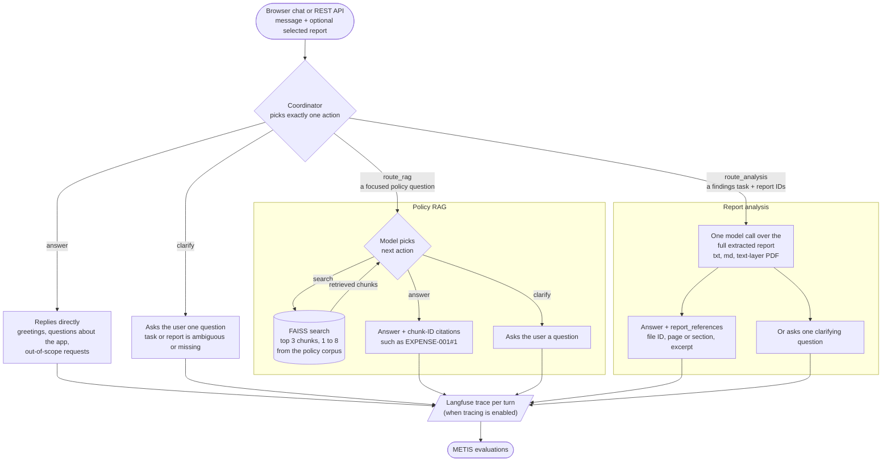

# Agentic Eval Toy App

A lightweight multi-agent application for demonstrating and regression-testing
METIS agent evaluation metrics.

> [!WARNING]
> **This is an experimental evaluation target, not a production-ready
> application.** Use synthetic or non-sensitive data only. The project has no
> availability, durability, or support SLA and must not be used to make or
> automate operational decisions.

## What it does

Agentic Eval Toy App is a small assistant you can use through a web chat page
or call directly through a REST API. In either one you can ask questions about
an employee-policy corpus, or upload a report and ask for a summary or its key
findings. Behind the chat sits a coordinator that reads each message and
decides how to handle it: it answers directly, asks you a clarifying question,
or delegates the task to a specialist agent. There are two specialists, and each
has one job. The policy RAG agent handles questions about the policy corpus: it
retrieves the relevant passages first, then answers using only those and cites
them. The report-analysis agent handles uploaded reports: it reads the whole
document, answers from it alone, and points back to the pages or sections it
relied on. Langfuse instrumentation is optional; when enabled, each turn is
exported as a trace.

### How a turn flows

Each message goes to the coordinator, which sees the user's text, the public
conversation history, and any report the user has selected. It makes one
structured decision per turn and picks exactly one of four actions.



A message is routed by the task it asks for, not by whether a file is attached,
so a file that merely contains a policy question still goes to policy RAG. The
coordinator never routes to more than one specialist in a turn, and it treats
report text as untrusted data, so instructions embedded in a report are not
followed.

**Policy RAG** answers only from retrieved policy text, and it is multi-step
and multi-turn. Within one user turn it loops: on each step it decides whether
to search, ask the user a question, or answer, and it can answer without
searching for greetings and questions about its own role. It also receives the
public conversation history, so a reply to its clarifying question in the next
turn is read with that earlier context. The loop is capped (by default four
model calls and two searches), and every cited chunk ID is checked against what
was actually retrieved, with mismatches flagged. Uploaded reports never enter
its index.

**Report analysis** reads the whole selected report in one model call and
answers only from it, separating what the report says from its own
interpretation. Each reference it returns is checked against the real page or
section, and a locator or excerpt that does not match is flagged as a
validation finding. By default a report may be up to 5 MiB, 50 PDF pages, and
100,000 extracted characters, and scanned PDFs are not supported.

## Quick start

You need Python 3.11+, [uv](https://docs.astral.sh/uv/), and Make (or Docker
with Compose; see [Running the application](docs/running.md)).

```bash
make install
TOYAPP_GENERATION_PROVIDER=deterministic TOYAPP_LANGFUSE_ENABLED=false make run
```

Then open <http://127.0.0.1:8000/>. This uses a deterministic model stand-in, so
it needs no API keys and costs nothing. The first run downloads the embedding
model. For a live model and Langfuse tracing, see
[Configuration](docs/configuration.md).

## Documentation

| Guide | Contents |
|---|---|
| [Capabilities and browser usage](docs/usage.md) | Full feature list, chat page, report upload |
| [API](docs/api.md) | Session, upload, and message routes with `curl` examples |
| [Configuration](docs/configuration.md) | `.env`, live model, Langfuse, Redis persistence |
| [Running the application](docs/running.md) | Local and Docker runs, endpoints, error logs |
| [Model-call limits](docs/rate-limits.md) | Backpressure settings and tuning |
| [Deploying to Airbase](docs/deploy-airbase.md) | Staging and production procedure |
| [Controlled trace generation](docs/trace-generation.md) | Control/defect trace pairs |
| [Repository structure](docs/repository-structure.md) | File-by-file map |
| [Architecture](architecture.md) | Components, data flows, limitations |
| [Contributing](CONTRIBUTING.md) | Setup, `make` targets, workflow |

## Support, security, and license

Support is best-effort. Report reproducible bugs and feature requests as
[GitHub issues](https://github.com/govtech-responsibleai/agentic-eval-toyapp/issues).
Do not report vulnerabilities publicly; follow [SECURITY.md](SECURITY.md).
Released under the [MIT License](LICENSE).
