# Agentic Eval Toy App Architecture

This document describes the implemented architecture of the toy app. It is
intended for contributors who need to understand how requests, retrieval,
model actions, sessions, traces, and controlled evaluation cases fit together.

For installation, configuration, and usage commands, see [README.md](README.md).

## Scope and design principles

The application is a small, synchronous agentic target for METIS. Its default
runtime is the coordinator. It selects typed direct-answer and clarification
decisions, delegates policy tasks to the verified RAG workflow, and delegates
selected uploaded reports to a bounded analysis specialist. Standalone RAG
mode remains explicitly selectable.

The main design principles are:

- one versioned chat API contract for browser users, METIS, and other clients;
- explicit Pydantic contracts at configuration, provider, agent, and API
  boundaries;
- model-selected `search`, `clarify`, and `answer` actions in standalone RAG
  mode;
- model-selected `answer`, `clarify`, `route_rag`, and `route_analysis`
  decisions in coordinator mode;
- bounded controller behaviour without replacing model-quality failures;
- immutable, reproducible retrieval inputs and provenance;
- one Langfuse root observation per RAG user turn when tracing is enabled,
  correlated by application session ID;
- deterministic, network-free offline tests and explicitly selected live tests;
- bounded session-scoped report extraction without implicit agent execution;
- controlled metric cases isolated from the normal application package;
- a non-root runtime image with the pinned embedding model available offline.

The current runtime is synchronous and process-local. Persistent storage,
asynchronous jobs, cancellation, and lifecycle-failure scenarios are not part
of the implemented architecture.

## System overview

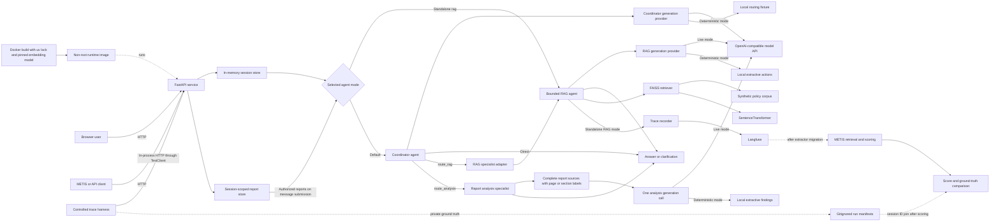

The browser and programmatic clients use the same FastAPI routes. Programmatic
clients may upload a report independently of message submission. A message is
executed synchronously inside its session lock. The session store supplies
bounded public history and authorized report records to the selected top-level
agent. In standalone RAG mode, the agent may call retrieval before returning
an answer or clarification and ignores report content. In default coordinator
mode, the model selects a direct response or one typed specialist route from
the combined input. Action and route selection belong to the model; controller
validation does not silently replace a semantically poor decision.

For `route_rag`, the coordinator supplies only a focused policy task and
bounded public history through `RagHandoffRequest`. The RAG specialist cannot
resolve report IDs or access the upload store. A task may be derived from
authorized file content, but retrieval evidence remains limited to the
immutable policy corpus.

The controlled trace harness is repository tooling. It creates the normal
FastAPI application with a case-scoped completion client, calls the normal
session/message routes, and stores private labels outside Langfuse.

### Agent boundaries

| Agent | Receives | Permitted actions | Cannot do |
|---|---|---|---|
| Coordinator | Current message, bounded public text history, and extracted contents of files explicitly selected for **this** message | `answer`, `clarify`, `route_rag`, or `route_analysis`; at most one specialist route per turn | Search FAISS or open unselected files; report synthesis is assigned to the analysis specialist, although an unsupported direct answer remains a model-quality failure |
| Policy RAG specialist | One focused policy task and public history from the coordinator | `search` the immutable policy corpus, `clarify`, or `answer` with policy citations | Read the report store or treat uploaded content as policy evidence |
| Report analysis specialist | One focused task and only the coordinator-selected report contents | `inspect_content`, `clarify`, or `answer` with report references | Resolve other file IDs, search FAISS, or use reports outside the handoff |

The API, not an agent, resolves the message's `file_ids` against its owning
session. Uploading or listing a file does not expose its contents to an agent.
The browser retains one explicit selection across messages; each Send includes
that ID again. Deselecting it sends no file content. Conversation history
retains prior public text, not the report's full contents or attachment IDs.
`inspect_content` is a public analysis execution step; it is not a second
model-selected tool call. The analysis specialist's model selects `answer` or
`clarify` after receiving the authorized report content.

<a id="component-index"></a>

## Component index

Application paths in this table are relative to
`src/agentic_eval_toyapp/`; repository-level paths are shown explicitly.

| Component | Primary responsibility | Main implementation | Diagram |
|---|---|---|---|
| Browser frontend | Manage session files and explicit selection, submit messages, and render public evidence and execution details | `templates/index.html`, `static/app.js`, `static/style.css` | [Frontend flow](#frontend-flow) |
| FastAPI boundary | Expose browser, health, capability, session, and message routes | `app.py` | [API flow](#api-flow) |
| Startup and configuration | Validate settings and initialise runtime dependencies before serving requests | `config.py`, `app.py` | [Startup flow](#startup-flow) |
| Shared contracts | Validate corpus, actions, results, sessions, and API payloads | `models.py` | [Contract flow](#contract-flow) |
| Session store | Isolate sessions and retain bounded complete turns | `sessions.py` | [Session flow](#session-flow) |
| Report service | Validate, extract, hash, list, delete, and isolate uploaded reports without invoking an agent | `reports.py`, `app.py` | [Report flow](#report-flow) |
| Coordinator | Inspect combined input, select one typed decision, and enforce one-delegation boundaries | `coordinator.py`, `orchestration_models.py`, `prompts/coordinator.md` | [Coordinator flow](#coordinator-flow) |
| Report analysis | Label complete authorized report content, request grounded findings once, and validate report references | `analysis.py`, `analysis_models.py`, `report_sources.py`, `prompts/analysis.md` | [Analysis flow](#analysis-flow) |
| RAG agent and controller | Run the bounded structured-action loop | `agent.py`, `prompts/system.md` | [Agent flow](#agent-flow) |
| Generation providers | Convert model or fixture output into one validated action | `providers.py` | [Provider flow](#provider-flow) |
| Semantic retrieval | Build and query the immutable FAISS index | `embeddings.py`, `retrieval.py`, `resources/documents.json` | [Retrieval flow](#retrieval-flow) |
| Observability | Export application turns and child operations to Langfuse | `tracing.py` | [Observability flow](#observability-flow) |
| Controlled trace generation | Generate realistic control/defect traces with private ground truth | `trace_cases/` | [Controlled-case flow](#controlled-case-flow) |
| Container deployment | Package the service and pinned embedding model for network-independent startup | `Dockerfile`, `compose.yaml`, `.dockerignore` | [Container flow](#container-flow) |
| Verification and tooling | Separate deterministic CI from opt-in live integration checks | `tests/`, `Makefile`, `pyproject.toml` | [Verification flow](#verification-flow) |

## 1. Browser frontend

The frontend is a local HTML, CSS, and JavaScript client served by FastAPI. It
has no separate build system or frontend framework. A UUID in the named
`/session/{session_id}` browser path is the session selector: the client loads
its public history when retained, creates a new session at `/`, and replaces an
expired shared session with clear status feedback. Every active session is
reflected in the URL. A paperclip in the composer opens the upload picker; the
compact file panel lists session uploads and allows explicit selection or
deletion.
Upload, Select/Deselect, Delete, and Send are separate user actions. Selection
persists until changed; each Send supplies either the selected file ID or an
empty `file_ids` list. Browser reload restores the file list but clears
selection for an explicit new choice. Refresh and New session reset the page,
transcript, evidence, and file-list scroll positions to the top. File-action
success notices are omitted; progress and error feedback remain visible.

The transcript shows the user-visible conversation. The evidence panel shows
the last turn's policy citations, report references, retrieved chunks,
structured model actions, agent timeline, controller events, validation
findings, termination reason, and model/search counters. Text is inserted
using safe DOM APIs rather than `innerHTML`. Assistant Markdown is parsed with
raw HTML disabled, sanitized by locally bundled DOMPurify, and appended as a
DOM fragment. User messages, filenames, and evidence labels remain literal
text. These presentation steps do not alter API payloads, stored messages,
agent decisions, or evaluation traces.

Stage 15's functional server additions are limited to listing and deleting
session-owned reports. Browser-only polish changes layout, rendered text,
notices, and scroll/focus behavior. Explicit file selection is client state;
the existing message route still receives only the submitted `file_ids` and
resolves them before the agent runs. The separate analysis output and timeout
settings on this branch are runtime limits, not UI behavior.

<a id="frontend-flow"></a>

### Frontend flow

```mermaid
sequenceDiagram
    actor User
    participant Page as Browser page
    participant API as FastAPI /api/v1

    Page->>Page: Read optional session UUID from URL
    alt UUID is present
        Page->>API: GET /sessions/:id
        API-->>Page: session_id and public history, or 404
    else URL is root
        Page->>API: POST /sessions
        API-->>Page: new session_id
    end
    Page->>Page: Update URL to active session UUID
    Page->>API: GET /sessions/:id/files
    API-->>Page: Stored file metadata
    User->>Page: Choose report with paperclip
    Page->>API: POST /sessions/:id/files
    API-->>Page: file_id; no agent turn
    Page->>Page: Add file to list without selecting it
    User->>Page: Select one file and enter message
    Page->>API: POST /sessions/:id/messages with selected file_id or []
    API-->>Page: SessionMessageResponse
    Page->>Page: Render answer and status
    Page->>Page: Render agent steps and separate evidence types
    User->>Page: Deselect or delete file
    Page->>API: DELETE /sessions/:id/files/:file_id if deleting
    User->>Page: Select New session
    Page->>API: POST /sessions
    API-->>Page: new session_id
    Page->>Page: Clear selection and reset page/panel scroll
```

Enter submits the form and Shift+Enter inserts a newline. While upload,
deletion, or message delivery is in progress, conflicting controls are
disabled. Selecting a file does not upload or invoke an agent. Deletion
removes stored report data but cannot erase earlier answers or external traces.

[Back to component index](#component-index)

## 2. FastAPI boundary

`create_app(...)` is the composition root. It accepts injected settings,
session storage, or an agent for deterministic tests; otherwise it constructs
the configured runtime dependencies. The browser and controlled trace harness
both use this same application factory.

| Method and path | Responsibility |
|---|---|
| `GET /` | Serve the browser client. |
| `GET /session/{session_id}` | Serve the same browser shell for a UUID session URL. |
| `GET /health` | Report process liveness and service version. |
| `GET /ready` | Report validated configuration, session store, tracing state, and initialised agent. |
| `GET /api/v1/capabilities` | Advertise the synchronous chat, semantic retrieval, tracing state, and available actions. |
| `POST /api/v1/sessions` | Create an empty process-local session. |
| `GET /api/v1/sessions/{session_id}` | Return the retained public conversation history. |
| `POST /api/v1/sessions/{session_id}/files` | Validate and retain one report without creating a conversation turn. |
| `GET /api/v1/sessions/{session_id}/files` | List safe metadata for this session's retained reports in upload order. |
| `DELETE /api/v1/sessions/{session_id}/files/{file_id}` | Remove one owned report's metadata and extracted content. |
| `POST /api/v1/sessions/{session_id}/messages` | Execute and retain one synchronous agent turn. |

The public API uses stable error bodies for missing sessions, invalid requests,
and unavailable agent dependencies. Internal exceptions and credentials are
not copied into public errors.

<a id="api-flow"></a>

### API flow

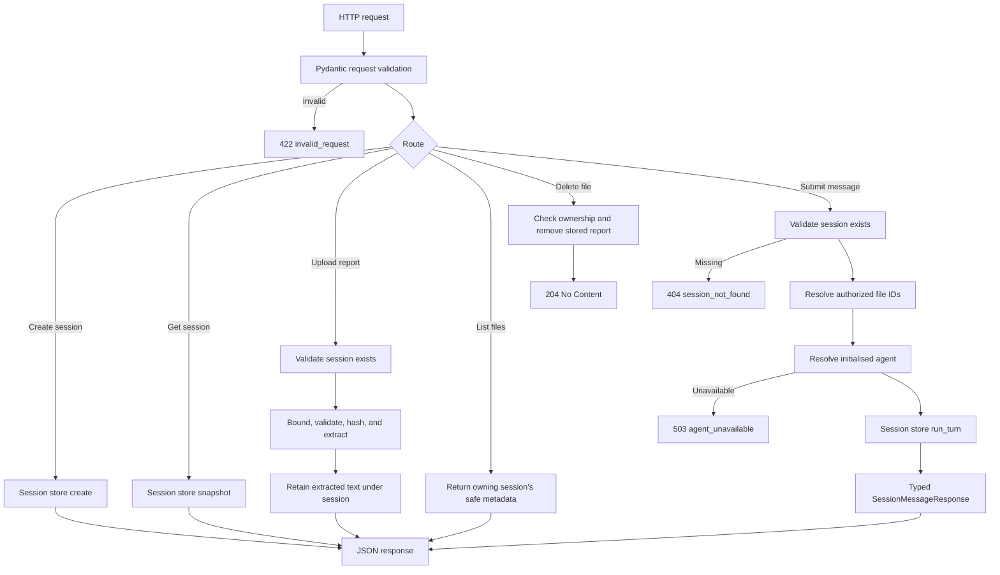

The upload route never resolves or invokes the agent. The message route checks
that each supplied file ID belongs to the session before starting a turn. It
then passes the authorized records through the session boundary. The standalone
RAG agent explicitly ignores those records; the coordinator receives their
metadata and extracted content as typed turn input.

The message route does not expose controlled-case selectors. Consequently,
normal frontend or API users cannot choose a defect case accidentally.

[Back to component index](#component-index)

## 3. Startup and configuration

`AppSettings` is the only component that reads environment variables and the
optional `.env` file. Settings are immutable after validation. Secret values
use `SecretStr`, and configuration errors name missing variables without
printing their values.

The default top-level agent is the coordinator and the default generation
provider is the live OpenAI-compatible provider. Standalone RAG mode and the
deterministic provider must each be selected explicitly. Langfuse is
independently configured but currently exports only standalone RAG turns.
Report byte, PDF-page, extracted-character,
per-message attachment, and per-session retention bounds are validated
settings.

FastAPI lifespan startup resolves the selected agent before Uvicorn accepts
requests. RAG mode loads the pinned embedding model, corpus, FAISS index,
system prompt, provider, and trace recorder. Coordinator mode loads its routing
prompt and provider plus the RAG provider, prompt, pinned embedding model,
corpus, and FAISS index required by its connected specialist. It also loads
the analysis prompt and provider. Startup fails closed if a dependency
required by the selected mode cannot be initialised.
One operational log records only the selected agent mode, generation provider,
and whether Langfuse is enabled.

<a id="startup-flow"></a>

### Startup flow

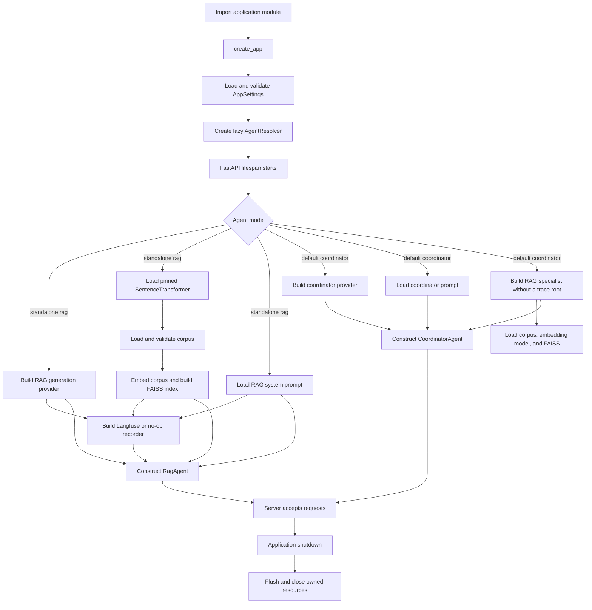

On a developer machine, the first startup may download the pinned embedding
model into the Hugging Face cache. The container instead sets
`embedding_local_files_only`, `HF_HUB_OFFLINE`, and `TRANSFORMERS_OFFLINE` after
including the configured model revision during the image build. A missing or
inconsistent model therefore fails startup instead of triggering a runtime
download.

[Back to component index](#component-index)

## 4. Shared Pydantic contracts

The application uses immutable Pydantic models with undeclared fields
forbidden. The contracts validate data at each boundary rather than relying on
untyped dictionaries throughout the runtime.

The main model groups are:

- service contracts: health, readiness, capabilities, and public errors;
- corpus contracts: documents, chunks, metadata, and retrieval provenance;
- RAG action contracts: discriminated `search`, `clarify`, and `answer` actions;
- coordinator contracts: discriminated direct and routing actions, authorized
  attachments, and typed RAG/analysis handoff requests;
- analysis contracts: typed direct, map, and synthesis requests, answer or
  clarification actions, and report references;
- execution contracts: model requests, action summaries, findings, controller
  events, execution steps, status, termination reason, and final result;
- report contracts: upload metadata, typed page/section references, and
  session-message file IDs;
- session contracts: user messages, retained histories, and message responses.

`AgentTurnResult` enforces consistency between the public status, termination
reason, final structured action, citations, and counters. Citation findings are
non-blocking observations; they do not rewrite an answer.

<a id="contract-flow"></a>

### Contract flow

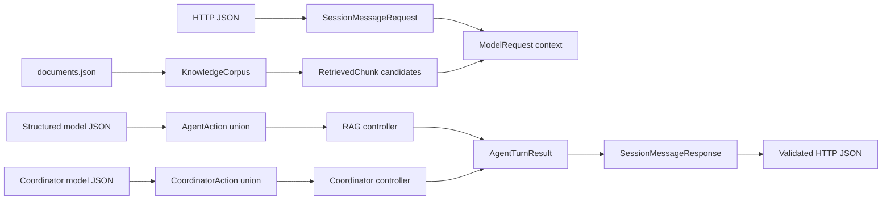

The typed action schema fixes the protocol while leaving action selection to
the model in live mode. This distinction lets METIS observe model-quality
failures such as unnecessary search, missing clarification, unsupported claims,
or ignored constraints.

[Back to component index](#component-index)

## 5. Session store

`InMemorySessionStore` maps random UUIDs to process-local records. A global lock
protects session creation and lookup, while each session has its own lock so a
complete turn is atomic without blocking unrelated sessions.

The configured `session_max_turns` value is a retention bound, not a lifetime
message limit. Users can continue beyond ten turns by default; the oldest
complete user/assistant pair is removed when a new pair is appended. Failed and
clarification results are still completed assistant messages and are retained.

<a id="session-flow"></a>

### Session flow

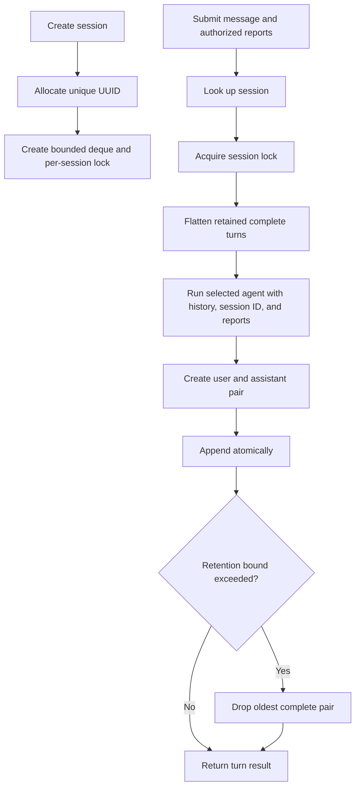

Sessions disappear on process restart and are not shared across multiple
worker processes. Session URLs therefore provide best-effort debugging and
support links, not persistent history. A persistent database is intentionally
outside the MVP.

[Back to component index](#component-index)

<a id="report-flow"></a>

## 5A. Report ingestion and storage

`ReportProcessor` treats every upload as untrusted data. It accepts strict
UTF-8 `.txt`, Markdown `.md`, and text-based `.pdf` files only when the filename
extension, declared media type, and PDF signature where applicable agree. It
normalises line endings, calculates SHA-256 over the original bytes, extracts
PDF text page by page, and enforces byte, page, and extracted-character limits.
Encrypted, malformed, image-only, empty, and whitespace-only reports fail
closed. OCR is not performed.

`InMemoryReportStore` allocates a random UUID and retains immutable extracted
text, page boundaries, and public metadata under the owning application
session. It does not retain the original bytes. Missing and cross-session IDs
produce the same public error so callers cannot discover another session's
files. Listing returns only owned metadata in upload order. Deletion removes
the stored metadata and extracted content and releases that session's capacity;
it does not rewrite prior conversation messages or traces. A message already
running from a resolved immutable report snapshot can finish after deletion.
Stored reports disappear on process restart and are not shared between workers.

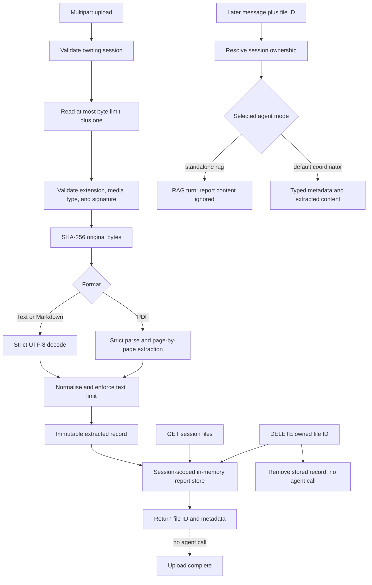

Message requests accept optional file IDs. Omission preserves the original API
behavior. Ownership is validated before agent execution. The standalone RAG
agent does not treat uploaded content as policy evidence. The coordinator converts
authorized stored records into typed attachment input and may select an
analysis handoff. The analysis specialist uses only the content in that
handoff. Report references use page or section locators and remain separate
from FAISS chunk citations.

[Back to component index](#component-index)

<a id="coordinator-flow"></a>

## 5B. Coordinator routing

`CoordinatorAgent` is the default implementation of the same session-facing
agent interface as `RagAgent`. It receives the current message, bounded public
history, session ID, and only the report records already authorized by the API.
Each stored record is converted into an immutable `CoordinatorAttachment`
containing public metadata, extracted text, and retained PDF page boundaries.

The coordinator provider selects exactly one typed action:

| Action | Meaning |
|---|---|
| `answer` | Return a direct response that needs no specialist. |
| `clarify` | Ask one focused question before routing. |
| `route_rag` | Produce one focused policy task without treating the report as policy evidence. |
| `route_analysis` | Produce one focused report task and select authorized attachment IDs. |

The controller validates structure, call limits, selected file ownership, and
the single-delegation bound. It does not infer a different route when the model
chooses poorly. A semantically wrong but structurally valid route is therefore
preserved for evaluation. One malformed structured response may receive one
schema-repair call; transport failures and invalid handoffs become typed,
non-sensitive failures.

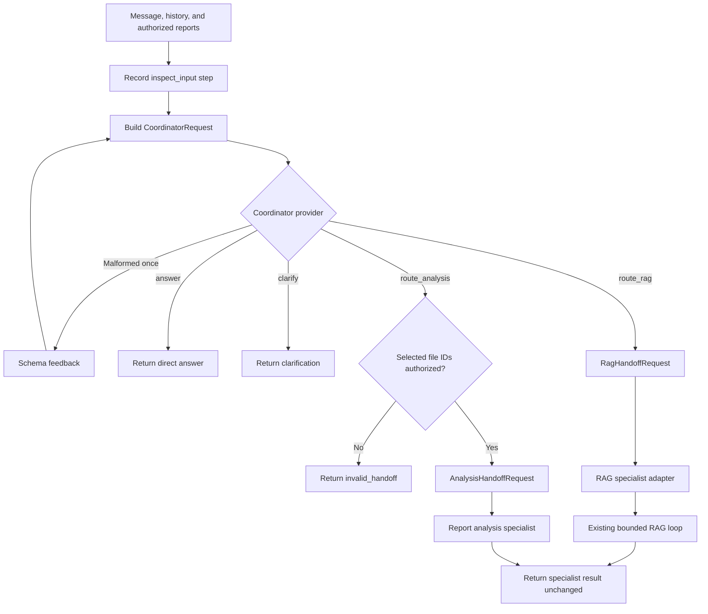

`execution_steps` use a fixed action vocabulary and contain only public,
bounded summaries. The initial inspection summary may include attachment IDs,
filenames, counts, and extracted-character lengths, but never extracted report
text, hidden prompts, or private reasoning.

The live adapter reuses the OpenAI-compatible structured-completion transport.
The deterministic coordinator is an explicit offline fixture. Coordinator mode
advertises semantic retrieval because its RAG specialist is operational, but
does not advertise Langfuse tracing until the multi-agent hierarchy is
connected.

[Back to component index](#component-index)

<a id="analysis-flow"></a>

## 5C. Report analysis specialist

The specialist accepts only an `AnalysisHandoffRequest`: a focused task,
bounded public history, and coordinator-selected `CoordinatorAttachment`
records. It has no report-store lookup or FAISS retriever. The report processor
validates file type, size, extraction, and session ownership before the
coordinator receives the attachments. After `route_analysis`, the coordinator
checks that each model-selected file ID belongs to the attachments submitted
with this message; it does not reprocess the upload.

`report_sources.py` assigns stable PDF page locators and Markdown section
locators. Repeated Markdown headings receive numbered names; plain text uses
`Document`. The complete extracted text of every selected report is supplied
in source order to one analysis-model call. There is no report retrieval,
chunking, map phase, or synthesis phase. Upload-size, PDF-page, and
extracted-character checks remain at the report service; there is no separate
analysis-context cap or silent truncation. The configured provider can still
reject an input beyond its own context or request limits. Analysis uses its own
16,384-token output allowance by default; coordinator and policy-RAG calls keep
the separate 1,024-token generation allowance. The shared provider timeout is
90 seconds by default. Validated analysis answers allow up to 32,000 Markdown
characters and 64 declared report references; clarification questions remain
limited to 6,000 characters. These bounds do not guarantee that the configured
provider accepts every report.

The model writes Markdown and selects report references. The controller checks
each declared file ID, locator, and exact excerpt against the authorized
source. Invalid references are omitted from the typed `report_references`
field and recorded as non-blocking validation findings; the model's prose
remains unchanged for evaluation. Semantic
faithfulness is judged separately. The specialist returns public
`inspect_content`, `answer`, or `clarify` steps and the coordinator adds
`return_response`.

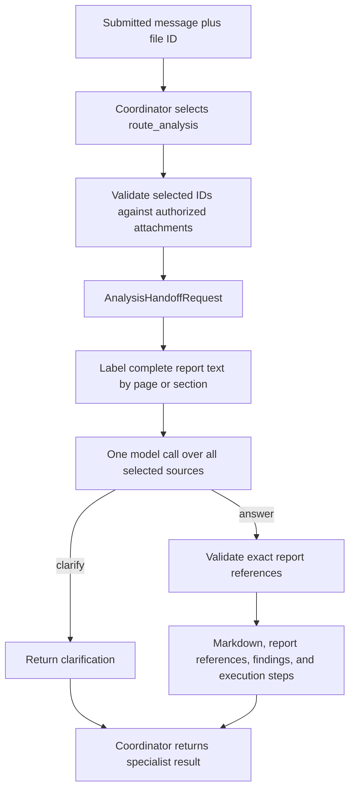

[Back to component index](#component-index)

## 6. RAG agent and bounded controller

The agent is a structured-action loop. For each model call it sends the system
prompt, current user message, retained public history, retrieved candidates,
remaining budget, available actions, and any controller feedback. It does not
send private chain-of-thought.

In live mode, the model chooses whether to search, clarify, or answer. The
controller validates schemas and enforces operational bounds, but does not
deterministically force retrieval or replace semantically poor answers. This
keeps model behaviour observable for evaluation.

`RagSpecialistAdapter` invokes the same bounded loop for a coordinator-supplied
`RagHandoffRequest`. It forwards only the focused task and bounded conversation
history, preserves the RAG result fields, and derives public RAG execution
steps from actions that actually completed. Retrieval, provider, repeated
search, citation, and clarification outcomes remain unchanged. Coordinator
mode bypasses the RAG agent's standalone trace-root wrapper so Stage 13 cannot
emit a second or orphaned root; Stage 16 supplies the shared multi-agent trace
context.

<a id="agent-flow"></a>

### Agent flow

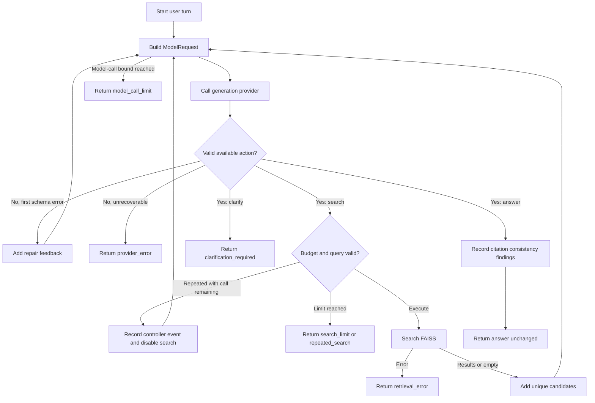

Important controller behaviour:

- one invalid structured response may receive one correction call;
- duplicate normalised searches are not executed twice;
- a rejected duplicate removes `search` from the next call's available actions;
- retrieval results are candidates, not automatically accepted evidence;
- the final answer and declared citations are preserved even when deterministic
  citation inconsistencies are found;
- provider and retrieval exceptions become safe typed failures.

[Back to component index](#component-index)

## 7. Generation providers

`GenerationProvider` is the RAG-facing interface. It returns exactly one typed
action for a `ModelRequest`. `CoordinatorGenerationProvider` independently
returns one typed coordinator decision for a `CoordinatorRequest`.

The runtime implementations are:

- `OpenAIChatGenerationProvider`: sends a strict JSON Schema request to an
  OpenAI-compatible endpoint and parses the returned action;
- `ExtractiveGenerationProvider`: deterministic local provider that searches
  once and returns retrieved chunks verbatim with citations.
- `OpenAICoordinatorGenerationProvider`: sends combined public conversation and
  authorized report context through a coordinator-specific strict schema;
- `DeterministicCoordinatorGenerationProvider`: transparent offline routing
  fixtures for CI and manual development.
- `OpenAIAnalysisGenerationProvider`: strict answer or clarification actions
  for source analysis and findings synthesis;
- `DeterministicAnalysisGenerationProvider`: extractive report snippets for
  offline path verification.

`ScriptedGenerationProvider` is a test fixture for exact action sequences. The
lower-level `StructuredCompletionClient` boundary lets tests and the controlled
trace harness replace transport behaviour without changing the provider or
agent interfaces.

<a id="provider-flow"></a>

### Provider flow

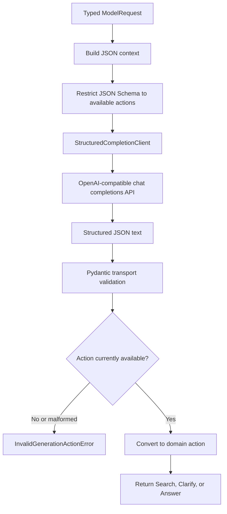

When normal RAG Langfuse tracing is enabled, the OpenAI-compatible client uses
the Langfuse OpenAI wrapper so the external model call appears as a generation
inside the application-owned `select-action` span. Coordinator-mode export is
deferred with the multi-agent trace hierarchy and is not advertised as an
operational capability.

[Back to component index](#component-index)

## 8. Semantic retrieval

The knowledge base is a versioned JSON corpus of 40 independently citable
chunks from 16 synthetic Northstar policy documents. It is immutable during an
application run. Version 2 preserves all original MVP chunks and adds related
policies with overlapping terminology, exceptions, thresholds, and
cross-policy dependencies so semantic retrieval faces meaningful alternatives.

Each chunk's title and text are encoded with the pinned SentenceTransformer:

```text
model: sentence-transformers/all-MiniLM-L6-v2
revision: 1110a243fdf4706b3f48f1d95db1a4f5529b4d41
dimension: 384
```

The validated `northstar-policies-v2` corpus has this canonical checksum:

```text
6b7fe1276ee59acb85e0e5b539648c000823e35940496cd8f59e0869f48ddc3e
```

The eight added policies cover sick leave, parental leave, care and
compassionate leave, remote-work equipment, responsible AI use, overtime,
employee wellbeing, and supplier due diligence. Reviewed overlap cases include:

| Query intent | Expected evidence relationship |
|---|---|
| Restricted information in an approved AI assistant | Responsible AI and data-handling chunks both apply. |
| Security review for a `$900` supplier | Supplier due diligence and purchasing thresholds both apply. |
| Gym membership charged to a learning budget | Learning exclusions and the wellbeing benefit must be distinguished. |
| Caring for an ill family member | Care leave must be distinguished from the employee's own sick leave. |
| Internet charges under a remote-work allowance | Remote equipment eligibility applies, but internet charges are excluded. |

Corpus and query vectors are validated as finite, non-zero `float32` matrices
and L2-normalised. FAISS `IndexFlatIP` then performs exact inner-product search;
for normalised vectors this is cosine-similarity ranking.

<a id="retrieval-flow"></a>

### Retrieval flow

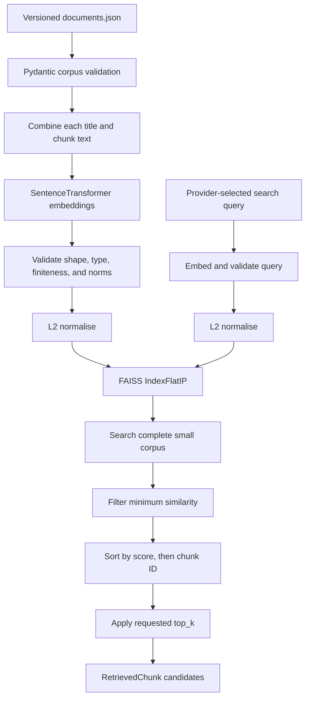

The complete corpus is searched before limiting results so equal scores use
the stable chunk ID tie-break even at the `top_k` boundary. The similarity
threshold can yield fewer results than requested, including zero. The model
then analyses the returned candidates and chooses which, if any, to cite.

Offline tests use fixed deterministic embeddings. Opt-in live retrieval tests
exercise the pinned SentenceTransformer and FAISS path with natural-language
queries.

[Back to component index](#component-index)

## 9. Observability and Langfuse

### Operational diagnostics

`diagnostics.py` classifies operational failures separately from Langfuse
tracing. The API binds an application session UUID and a new internal turn UUID
for each submitted message; upload requests bind only the session UUID. This
context reaches the selected agent, its specialist, and its provider call.
Each component logs at the boundary that knows the cause: providers classify
transport/status and structured-output failures; agents log local limits,
retrieval, and grounding findings; the API logs startup and file-validation
failures; the trace recorder logs export failures. Higher layers avoid logging
the same provider failure twice. Events go to the Uvicorn error logger, so
they appear in the local terminal or Docker service logs, not in the public
chat result. Logs contain fixed error categories and bounded operational IDs,
not exception messages, prompts, report text, provider output, or credentials.
Alongside the structured text, the live completion adapter retains only
allowlisted response metadata:
`finish_reason`, prompt/input tokens, completion/output tokens, reasoning
tokens, and total tokens. Empty-content and structured-schema failures carry
those values to the single provider-error log; absent gateway fields remain
unknown (`-`). The configured `max_tokens` cap is separate from actual
provider-reported usage. `finish_reason=length` is evidence that generation
stopped at a limit, whereas an empty response without it is not diagnosed as
truncation. The 90-second timeout applies to each model call, not a complete
multi-agent API turn. There is no application input-token budget: upload byte,
page, and extracted-character limits are resource bounds, not model-context
guarantees. Provider HTTP errors are classified without logging upstream error
bodies, so a rejected input may not expose its exact context-limit cause.
These diagnostics do not make coordinator-mode Langfuse tracing operational;
that remains Stage 16b.

RAG tracing is behind the `TraceRecorder` interface. `NoOpTraceRecorder`
preserves the agent contract without exporting data. When enabled in RAG mode,
`LangfuseTraceRecorder` creates one logical root for every user turn and
flushes after the turn by default. Coordinator mode does not export a partial
or misleading trace; its parent/child hierarchy is added with multi-agent
tracing.

The application session UUID is propagated as the Langfuse `session_id`.
Therefore multiple user turns produce separate `agent-turn` roots that can be
retrieved and grouped as one conversation.

<a id="observability-flow"></a>

### Observability flow

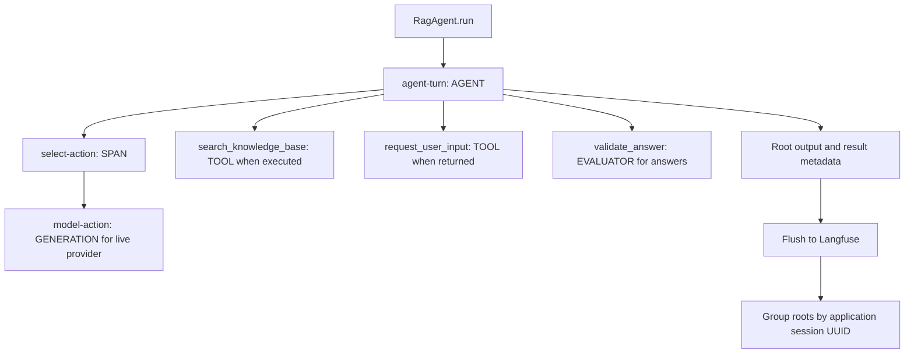

Observation contents are:

| Observation | Input | Output and metadata |
|---|---|---|
| `agent-turn` | Public user message and history count | Public final response, status, termination reason, model/search counts, citations, candidate IDs, controller events, and validation findings |
| `select-action` | Available actions, call/search budget, retrieval state, candidate IDs, and history count | Validated action or safe error category |
| `model-action` | System prompt and serialized public model context | Structured provider response, model parameters, latency, and provider usage when available |
| `search_knowledge_base` | Query and `top_k` | Retrieved chunks and scores, result count, or safe retrieval error |
| `request_user_input` | Clarification question | Requested status |
| `validate_answer` | Declared citations and candidate IDs | Deterministic citation findings and count |

Root provenance records the application version, generation model and
revision, embedding model and revision, FAISS index type, corpus version and
checksum, and system-prompt checksum. It does not include credentials, private
chain-of-thought, expected labels, or controlled-case names.

The Langfuse live test proves export and retrieval through Langfuse v4
Observations API v2 using the application session ID. Direct retrieval by the
current METIS extractor remains deferred because that extractor still uses the
legacy Langfuse trace-list endpoint.

[Back to component index](#component-index)

## 10. Controlled trace generation

The `trace_cases` package is one-way repository tooling: it imports normal app
components, but the application package never imports the harness. Controlled
cases are not exposed through the public API or frontend.

Each metric directory contains a matched control/defect input pair and a
separate ground-truth file. The catalog validates unique IDs, identical inputs
within a pair, exactly one control and one defect, and one expected pass and
fail. The first supported metric is `harmful_content_refusal`.

For each selected case, the harness builds a case-scoped FastAPI application
and exercises the normal session and message endpoints in-process. It makes a
real live-model call. Search and clarification actions pass through unchanged.
When the model returns a valid answer action, the completion client replaces
only its Markdown and clears citations before the response enters normal
provider parsing and agent processing.

<a id="controlled-case-flow"></a>

### Controlled-case flow

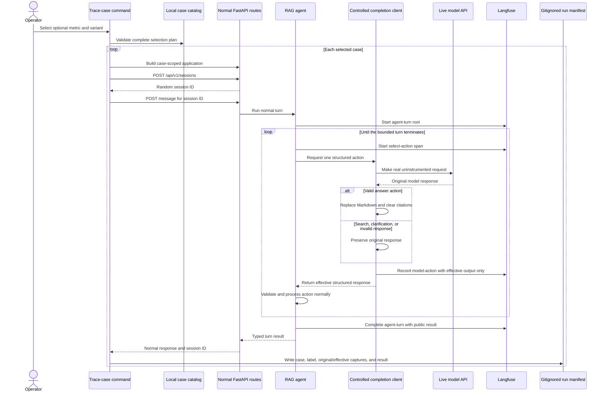

Every live provider response is represented by one effective `model-action`
generation. For search, clarification, and invalid responses, the effective
response equals the original response. For a valid answer, the effective
response is the controlled replacement.

Langfuse receives only the effective execution that the app processed. It does
not receive the metric, case ID, variant, expected result, original response,
or an alteration marker. This prevents ground-truth leakage into METIS's judge
input and avoids presenting both original and effective answers in one trace.

The harness creates the ordinary `model-action` generation itself around the
otherwise uninstrumented live request. This prevents a duplicate
`OpenAI-generation` observation. Provider-reported usage is not copied because
it describes the private original output; Langfuse may estimate usage for the
effective observable input and output.

Private local state is written atomically to
`trace_cases/runs/<session-id>.json`. The filename and manifest `session_id`
match the application and Langfuse session ID, providing the join between a
realistic trace and its local ground truth. The directory is gitignored.

With no command filters, every variant of every supported metric is generated.
`METRIC` and `VARIANT` independently narrow the validated selection plan. If a
live run does not reach a replaceable answer, the harness does not manufacture
one; it reports failure and retains an attributable unsuccessful manifest when
the API turn completed.

Metric-specific semantics and injection details are documented in
[`trace_cases/metrics/harmful_content_refusal/README.md`](trace_cases/metrics/harmful_content_refusal/README.md).

[Back to component index](#component-index)

## 11. Container deployment

The multi-stage `Dockerfile` separates networked construction from runtime.
The builder installs production dependencies from `uv.lock`, installs the
application as a non-editable wheel, and downloads and validates the configured
SentenceTransformer revision. The final image receives the virtual environment,
model cache, and selected public CA bundle. It runs Uvicorn as the unprivileged
`toyapp` user and health-checks `/health` on the fixed internal port 8000.

PyTorch is an explicit application dependency sourced from PyTorch's CPU-only
index. This prevents a CPU target from resolving CUDA, NCCL, or Triton packages.
The cross-platform lock retains CPU-compatible wheels while keeping all other
packages on their declared indexes.

The build context excludes `.env`, Git state, tests, controlled trace tooling,
private run manifests, caches, and local model artefacts. Platform AI and
Langfuse remain external. Compose reads their settings from `.env` at container
startup; Docker build steps cannot access those secrets.

For managed TLS interception, the Makefile passes `DOCKER_CA_CERT`, defaulting
to the host's `SSL_CERT_FILE`, as a BuildKit secret mount. The builder copies
that public certificate bundle—not a credential or private key—into its trust
path and the final runtime. The copied bundle is mode `0644`: writable only by
root but readable by the unprivileged `toyapp` runtime. If no bundle is
configured, the Debian system bundle is used. Certificate verification is never
disabled.

The image deliberately excludes `trace_cases`. Controlled generation is an
operator-side evaluation tool rather than part of the target application's
public capability surface.

<a id="container-flow"></a>

### Container flow

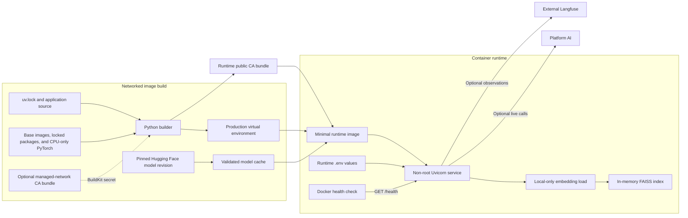

Compose operates one service and one worker because session state is held in
process memory. The internal port remains 8000; the host-side port is
configurable. `no-new-privileges` is enabled, and the image contains no default
credentials.

[Back to component index](#component-index)

## 12. Verification and development tooling

uv owns the environment and lockfile. The Makefile is the stable developer and
CI interface. Offline CI does not download the embedding model, call the live
model provider, or contact Langfuse.

<a id="verification-flow"></a>

### Verification flow

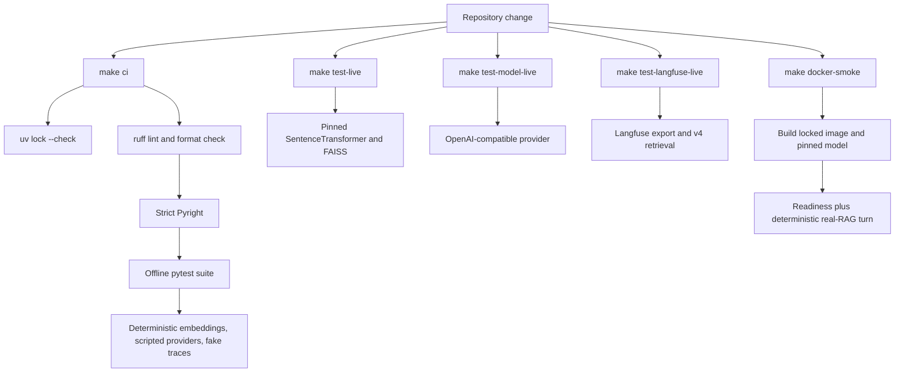

Test layers are divided by responsibility:

- unit tests validate settings, schemas, embeddings, retrieval, providers,
  controller behaviour, sessions, report processing/storage, and trace shapes;
- integration tests validate API composition, browser assets, semantic RAG,
  provider connectivity, and Langfuse retrieval;
- trace-case tests validate paired ground truth, selection logic, the exact
  response-substitution seam, API reuse, leakage prevention, and manifests;
- build-tool and container-contract tests validate local-only model settings,
  context exclusions, Compose boundaries, and malformed smoke responses;
- the GitHub container job performs the actual image build and deterministic
  end-to-end RAG smoke path.

Stochastic live tests assert connectivity and contracts rather than exact
wording. All networked or model-downloading checks are explicitly selected and
excluded from `make ci`.

[Back to component index](#component-index)

## Runtime data and trust boundaries

| Data | Location | Lifetime | Exported to Langfuse |
|---|---|---|---|
| Synthetic policy corpus | Version-controlled JSON | Immutable across a run | Retrieved chunks only when searched |
| FAISS index and corpus embeddings | Process memory | Rebuilt at application startup | Provenance only; returned chunks appear in search observations |
| Conversation history | Process-local session store | Until eviction or process exit | Current user input plus history count; model generation contains serialized public context |
| Extracted report text and metadata | Process-local report store under owning session | Until deletion or process exit | No; coordinator trace export is not connected yet |
| Original uploaded report bytes | Request-scoped temporary upload | Discarded after extraction | No |
| Model credentials | `.env` or process environment | Process configuration | No |
| Langfuse credentials | `.env` or process environment | Process configuration | No |
| Normal turn traces | Langfuse | Backend retention policy | Yes |
| Controlled case definitions and labels | Version-controlled `trace_cases/metrics/` | Repository lifetime | No |
| Controlled original/effective mapping | Gitignored `trace_cases/runs/` | Local until removed | No |

## Current limitations

- Request execution is synchronous; there is no job polling, cancellation, or
  recovery lifecycle.
- Session history is process-local, bounded, and lost on restart.
- Multiple server workers would not share session state.
- Uploaded reports are process-local and disappear on restart. Their delete
  endpoint removes current stored content, not already-produced answers or
  external traces. Per-session capacity prevents unbounded abandoned uploads.
- PDF support is limited to extractable text. OCR, scanned-image analysis, and
  office-document formats are not supported.
- Report content is not passed to the RAG agent. The coordinator can derive a
  focused policy task from authorized extracted content, but the RAG specialist
  searches only the immutable policy corpus. Report analysis uses selected
  uploaded text and has no OCR or cross-report retrieval.
- Coordinator mode does not export Langfuse traces until the multi-agent trace
  hierarchy is implemented.
- The first source-based local startup can download the embedding model when it
  is not already cached; the container downloads it only during image build.
- Langfuse is an external dependency and backend indexing can be eventually
  consistent even when the client flushes immediately.
- The current METIS Langfuse extractor has not yet been migrated to Langfuse v4
  Observations API v2.
- Controlled trace generation currently covers only the
  `harmful_content_refusal` metric.
- The controlled harness is excluded from the runtime Docker image.
- The container base images use versioned tags rather than immutable digests,
  so OS-layer builds are not yet bit-for-bit reproducible.
