# Agentic Eval Toy App Architecture

This document describes the implemented architecture of the toy app. It is
intended for contributors who need to understand how requests, retrieval,
model actions, sessions, traces, and controlled evaluation cases fit together.

For installation, configuration, and usage commands, see [README.md](README.md).

## Scope and design principles

The application is a small, synchronous retrieval-augmented generation (RAG)
target for METIS. It deliberately has one agent and a narrow action set so that
evaluation results can be attributed to observable model and controller
behaviour.

The main design principles are:

- one versioned chat API contract for browser users, METIS, and other clients;
- explicit Pydantic contracts at configuration, provider, agent, and API
  boundaries;
- model-selected `search`, `clarify`, and `answer` actions in the default
  live mode;
- bounded controller behaviour without replacing model-quality failures;
- immutable, reproducible retrieval inputs and provenance;
- one Langfuse root observation per user turn when tracing is enabled,
  correlated by application session ID;
- deterministic, network-free offline tests and explicitly selected live tests;
- controlled metric cases isolated from the normal application package.

The current runtime is synchronous and process-local. Docker packaging,
persistent storage, asynchronous jobs, cancellation, and lifecycle-failure
scenarios are not part of the implemented architecture yet.

## System overview

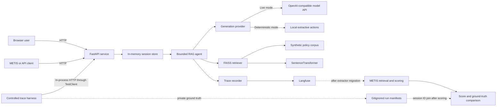

The browser and programmatic clients use the same FastAPI routes. A message is
executed synchronously inside its session lock. The session store supplies
bounded public history to the agent, the configured generation provider selects
the next structured action, and the agent may call retrieval before returning
an answer or clarification. In the default live mode, action selection belongs
to the model. When enabled, tracing observes the same execution without
changing the public result.

The controlled trace harness is repository tooling. It creates the normal
FastAPI application with a case-scoped completion client, calls the normal
session/message routes, and stores private labels outside Langfuse.

<a id="component-index"></a>

## Component index

Application paths in this table are relative to
`src/agentic_eval_toyapp/`; repository-level paths are shown explicitly.

| Component | Primary responsibility | Main implementation | Diagram |
|---|---|---|---|
| Browser frontend | Create sessions, submit messages, and render public evidence and execution details | `templates/index.html`, `static/app.js`, `static/style.css` | [Frontend flow](#frontend-flow) |
| FastAPI boundary | Expose browser, health, capability, session, and message routes | `app.py` | [API flow](#api-flow) |
| Startup and configuration | Validate settings and initialise runtime dependencies before serving requests | `config.py`, `app.py` | [Startup flow](#startup-flow) |
| Shared contracts | Validate corpus, actions, results, sessions, and API payloads | `models.py` | [Contract flow](#contract-flow) |
| Session store | Isolate sessions and retain bounded complete turns | `sessions.py` | [Session flow](#session-flow) |
| RAG agent and controller | Run the bounded structured-action loop | `agent.py`, `prompts/system.md` | [Agent flow](#agent-flow) |
| Generation providers | Convert model or fixture output into one validated action | `providers.py` | [Provider flow](#provider-flow) |
| Semantic retrieval | Build and query the immutable FAISS index | `embeddings.py`, `retrieval.py`, `resources/documents.json` | [Retrieval flow](#retrieval-flow) |
| Observability | Export application turns and child operations to Langfuse | `tracing.py` | [Observability flow](#observability-flow) |
| Controlled trace generation | Generate realistic control/defect traces with private ground truth | `trace_cases/` | [Controlled-case flow](#controlled-case-flow) |
| Verification and tooling | Separate deterministic CI from opt-in live integration checks | `tests/`, `Makefile`, `pyproject.toml` | [Verification flow](#verification-flow) |

## 1. Browser frontend

The frontend is a local HTML, CSS, and JavaScript client served by FastAPI. It
has no separate build system or frontend framework. It creates a session on
page load, sends messages to the versioned API, and renders only fields from
the public response schema.

The transcript shows the user-visible conversation. The evidence panel shows
the last turn's citations, retrieved candidate chunks, similarity scores,
structured model actions, controller events, validation findings, termination
reason, and model/search counters. Text is inserted using safe DOM APIs rather
than `innerHTML`.

<a id="frontend-flow"></a>

### Frontend flow

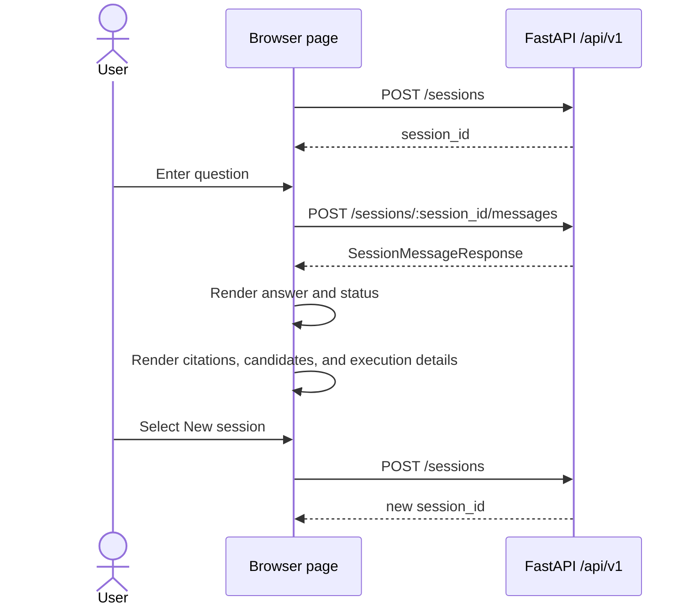

Enter submits the form and Shift+Enter inserts a newline. While a request is in
progress, the message and new-session controls are disabled to prevent
overlapping browser requests.

[Back to component index](#component-index)

## 2. FastAPI boundary

`create_app(...)` is the composition root. It accepts injected settings,
session storage, or an agent for deterministic tests; otherwise it constructs
the configured runtime dependencies. The browser and controlled trace harness
both use this same application factory.

| Method and path | Responsibility |
|---|---|
| `GET /` | Serve the browser client. |
| `GET /health` | Report process liveness and service version. |
| `GET /ready` | Report validated configuration, session store, tracing state, and initialised agent. |
| `GET /api/v1/capabilities` | Advertise the synchronous chat, semantic retrieval, tracing state, and available actions. |
| `POST /api/v1/sessions` | Create an empty process-local session. |
| `GET /api/v1/sessions/{session_id}` | Return the retained public conversation history. |
| `POST /api/v1/sessions/{session_id}/messages` | Execute and retain one synchronous agent turn. |

The public API uses stable error bodies for missing sessions, invalid requests,
and unavailable agent dependencies. Internal exceptions and credentials are
not copied into public errors.

<a id="api-flow"></a>

### API flow

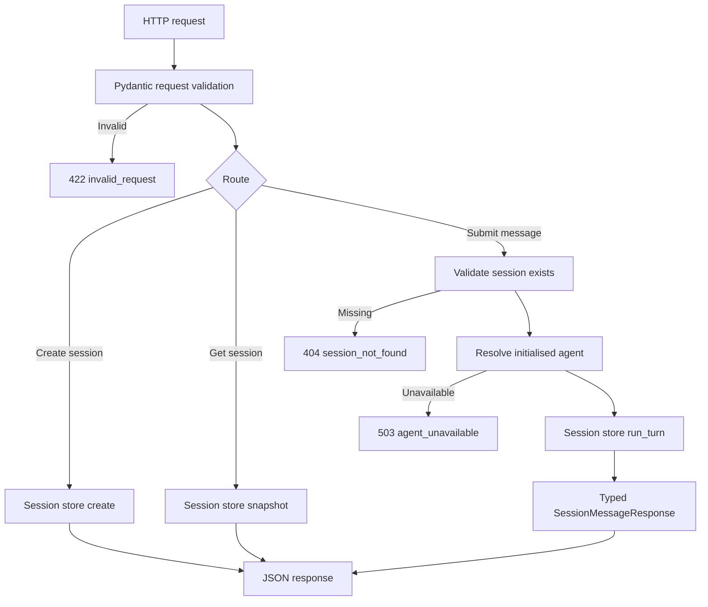

The message route does not expose controlled-case selectors. Consequently,
normal frontend or API users cannot choose a defect case accidentally.

[Back to component index](#component-index)

## 3. Startup and configuration

`AppSettings` is the only component that reads environment variables and the
optional `.env` file. Settings are immutable after validation. Secret values
use `SecretStr`, and configuration errors name missing variables without
printing their values.

The default generation provider is the live OpenAI-compatible provider. A
deterministic provider must be selected explicitly. Langfuse is independently
opt-in.

FastAPI lifespan startup resolves the agent before Uvicorn accepts requests.
This initialises the generation provider, loads the pinned embedding model,
validates and embeds the corpus, builds the FAISS index, loads the system
prompt, and constructs either a real or no-op trace recorder. Startup fails
closed if any required dependency cannot be initialised.

<a id="startup-flow"></a>

### Startup flow

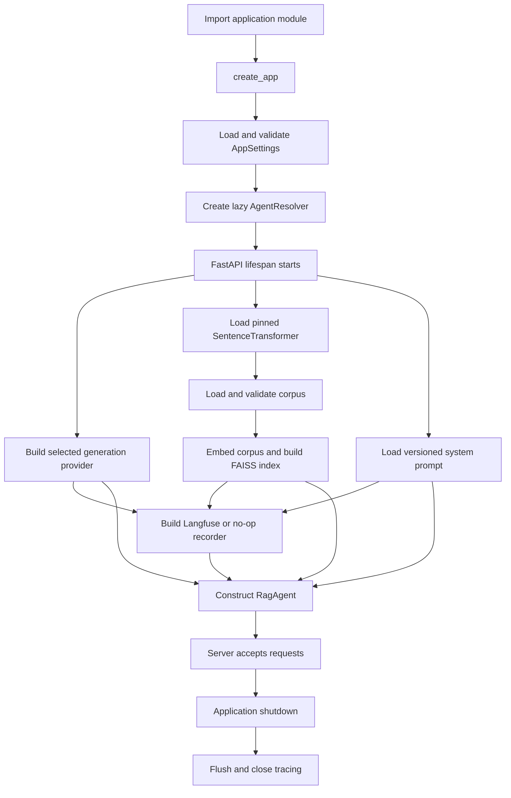

On a developer machine, the first startup may download the pinned embedding
model into the Hugging Face cache. Moving that download into the Docker image
build is a Stage 10 deployment decision and is not current runtime behaviour.

[Back to component index](#component-index)

## 4. Shared Pydantic contracts

The application uses immutable Pydantic models with undeclared fields
forbidden. The contracts validate data at each boundary rather than relying on
untyped dictionaries throughout the runtime.

The main model groups are:

- service contracts: health, readiness, capabilities, and public errors;
- corpus contracts: documents, chunks, metadata, and retrieval provenance;
- action contracts: discriminated `search`, `clarify`, and `answer` actions;
- execution contracts: model requests, action summaries, findings, controller
  events, status, termination reason, and final result;
- session contracts: user messages, retained histories, and message responses.

`AgentTurnResult` enforces consistency between the public status, termination
reason, final structured action, citations, and counters. Citation findings are
non-blocking observations; they do not rewrite an answer.

<a id="contract-flow"></a>

### Contract flow

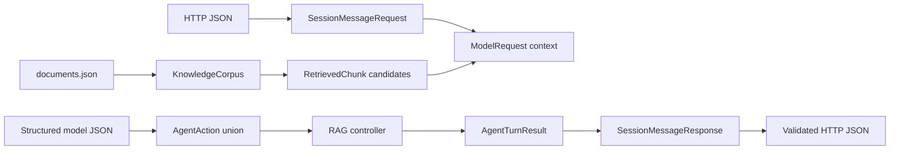

The typed action schema fixes the protocol while leaving action selection to
the model in live mode. This distinction lets METIS observe model-quality
failures such as unnecessary search, missing clarification, unsupported claims,
or ignored constraints.

[Back to component index](#component-index)

## 5. Session store

`InMemorySessionStore` maps random UUIDs to process-local records. A global lock
protects session creation and lookup, while each session has its own lock so a
complete turn is atomic without blocking unrelated sessions.

The configured `session_max_turns` value is a retention bound, not a lifetime
message limit. Users can continue beyond ten turns by default; the oldest
complete user/assistant pair is removed when a new pair is appended. Failed and
clarification results are still completed assistant messages and are retained.

<a id="session-flow"></a>

### Session flow

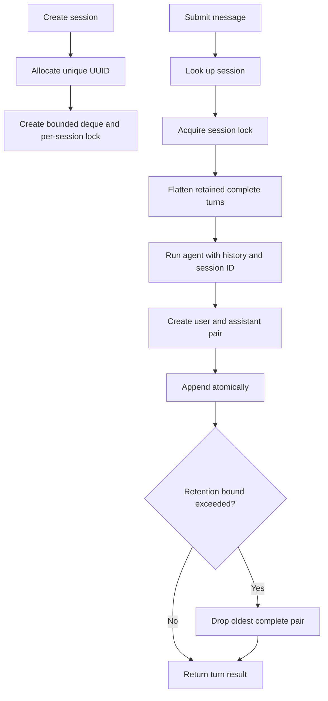

Sessions disappear on process restart and are not shared across multiple
worker processes. A persistent database is intentionally outside the MVP.

[Back to component index](#component-index)

## 6. RAG agent and bounded controller

The agent is a structured-action loop. For each model call it sends the system
prompt, current user message, retained public history, retrieved candidates,
remaining budget, available actions, and any controller feedback. It does not
send private chain-of-thought.

In live mode, the model chooses whether to search, clarify, or answer. The
controller validates schemas and enforces operational bounds, but does not
deterministically force retrieval or replace semantically poor answers. This
keeps model behaviour observable for evaluation.

<a id="agent-flow"></a>

### Agent flow

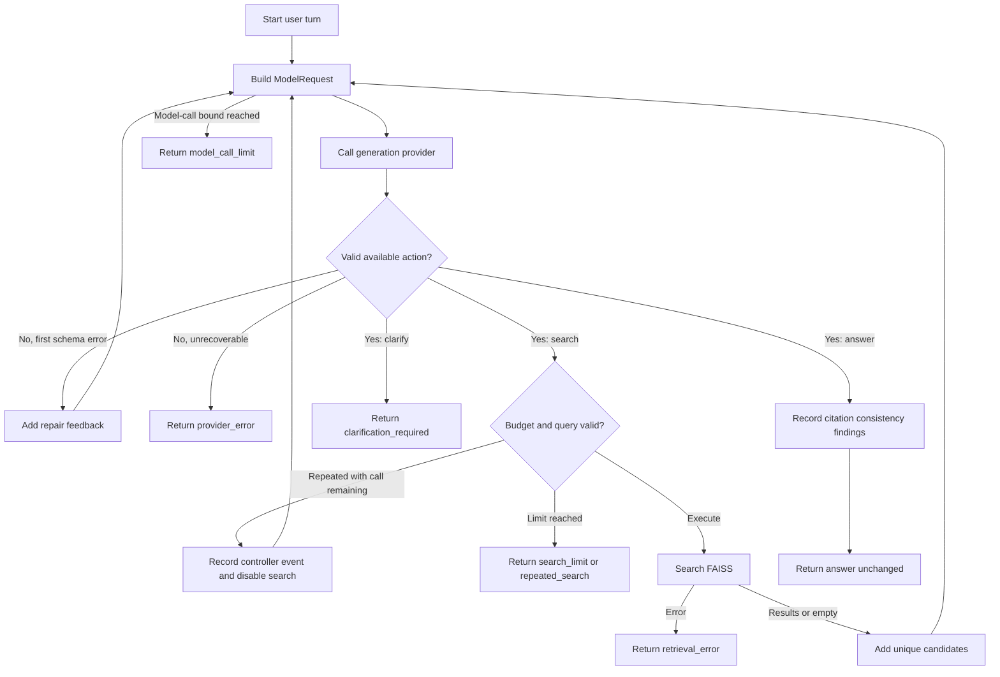

Important controller behaviour:

- one invalid structured response may receive one correction call;
- duplicate normalised searches are not executed twice;
- a rejected duplicate removes `search` from the next call's available actions;
- retrieval results are candidates, not automatically accepted evidence;
- the final answer and declared citations are preserved even when deterministic
  citation inconsistencies are found;
- provider and retrieval exceptions become safe typed failures.

[Back to component index](#component-index)

## 7. Generation providers

`GenerationProvider` is the agent-facing interface. It returns exactly one
typed action for a `ModelRequest`.

The runtime implementations are:

- `OpenAIChatGenerationProvider`: sends a strict JSON Schema request to an
  OpenAI-compatible endpoint and parses the returned action;
- `ExtractiveGenerationProvider`: deterministic local provider that searches
  once and returns retrieved chunks verbatim with citations.

`ScriptedGenerationProvider` is a test fixture for exact action sequences. The
lower-level `StructuredCompletionClient` boundary lets tests and the controlled
trace harness replace transport behaviour without changing the provider or
agent interfaces.

<a id="provider-flow"></a>

### Provider flow

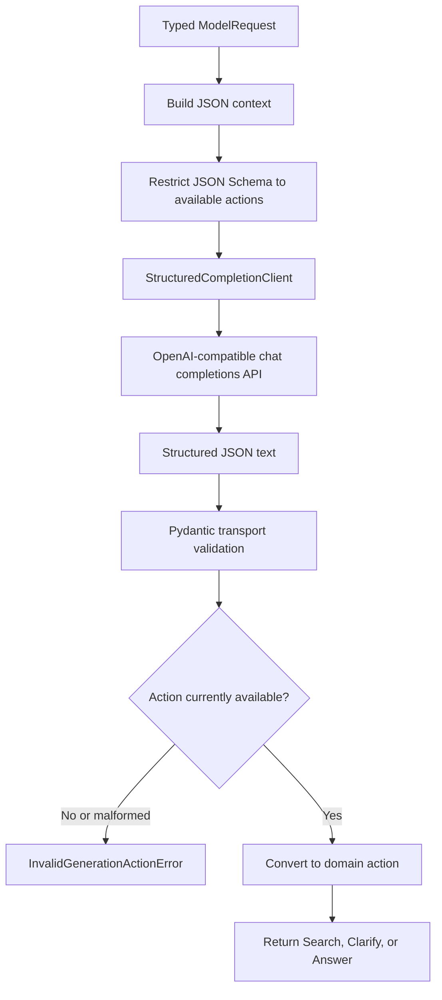

When normal Langfuse tracing is enabled, the OpenAI-compatible client uses the
Langfuse OpenAI wrapper so the external model call appears as a generation
inside the application-owned `select-action` span.

[Back to component index](#component-index)

## 8. Semantic retrieval

The knowledge base is a versioned JSON corpus of 16 independently citable
chunks from eight synthetic Northstar policy documents. It is immutable during
an application run.

Each chunk's title and text are encoded with the pinned SentenceTransformer:

```text
model: sentence-transformers/all-MiniLM-L6-v2
revision: 1110a243fdf4706b3f48f1d95db1a4f5529b4d41
dimension: 384
```

The validated `northstar-policies-v1` corpus has this canonical checksum:

```text
fd79e97d578089ebef4b5c3bf7ada9ee4e5545bf72c66fbb8fb1abd2fa8682ee
```

Corpus and query vectors are validated as finite, non-zero `float32` matrices
and L2-normalised. FAISS `IndexFlatIP` then performs exact inner-product search;
for normalised vectors this is cosine-similarity ranking.

<a id="retrieval-flow"></a>

### Retrieval flow

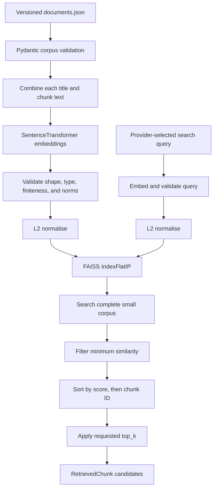

The complete corpus is searched before limiting results so equal scores use
the stable chunk ID tie-break even at the `top_k` boundary. The similarity
threshold can yield fewer results than requested, including zero. The model
then analyses the returned candidates and chooses which, if any, to cite.

Offline tests use fixed deterministic embeddings. Opt-in live retrieval tests
exercise the pinned SentenceTransformer and FAISS path with natural-language
queries.

[Back to component index](#component-index)

## 9. Observability and Langfuse

Tracing is behind the `TraceRecorder` interface. `NoOpTraceRecorder` preserves
the agent contract without exporting data. When enabled,
`LangfuseTraceRecorder` creates one logical root for every user turn and
flushes after the turn by default.

The application session UUID is propagated as the Langfuse `session_id`.
Therefore multiple user turns produce separate `agent-turn` roots that can be
retrieved and grouped as one conversation.

<a id="observability-flow"></a>

### Observability flow

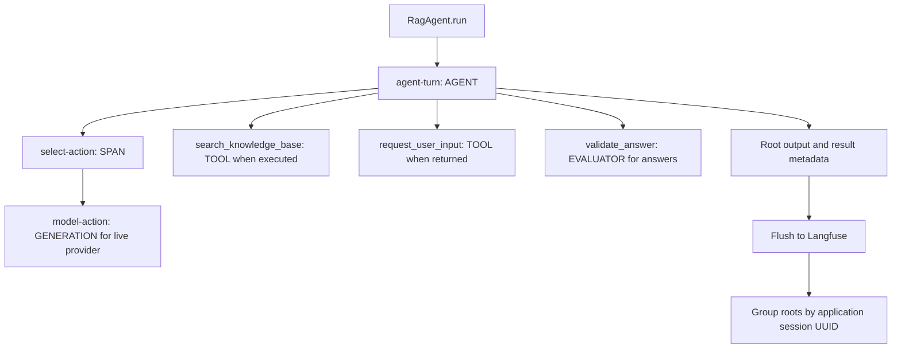

Observation contents are:

| Observation | Input | Output and metadata |
|---|---|---|
| `agent-turn` | Public user message and history count | Public final response, status, termination reason, model/search counts, citations, candidate IDs, controller events, and validation findings |
| `select-action` | Available actions, call/search budget, retrieval state, candidate IDs, and history count | Validated action or safe error category |
| `model-action` | System prompt and serialized public model context | Structured provider response, model parameters, latency, and provider usage when available |
| `search_knowledge_base` | Query and `top_k` | Retrieved chunks and scores, result count, or safe retrieval error |
| `request_user_input` | Clarification question | Requested status |
| `validate_answer` | Declared citations and candidate IDs | Deterministic citation findings and count |

Root provenance records the application version, generation model and
revision, embedding model and revision, FAISS index type, corpus version and
checksum, and system-prompt checksum. It does not include credentials, private
chain-of-thought, expected labels, or controlled-case names.

The Langfuse live test proves export and retrieval through Langfuse v4
Observations API v2 using the application session ID. Direct retrieval by the
current METIS extractor remains deferred because that extractor still uses the
legacy Langfuse trace-list endpoint.

[Back to component index](#component-index)

## 10. Controlled trace generation

The `trace_cases` package is one-way repository tooling: it imports normal app
components, but the application package never imports the harness. Controlled
cases are not exposed through the public API or frontend.

Each metric directory contains a matched control/defect input pair and a
separate ground-truth file. The catalog validates unique IDs, identical inputs
within a pair, exactly one control and one defect, and one expected pass and
fail. The first supported metric is `harmful_content_refusal`.

For each selected case, the harness builds a case-scoped FastAPI application
and exercises the normal session and message endpoints in-process. It makes a
real live-model call. Search and clarification actions pass through unchanged.
When the model returns a valid answer action, the completion client replaces
only its Markdown and clears citations before the response enters normal
provider parsing and agent processing.

<a id="controlled-case-flow"></a>

### Controlled-case flow

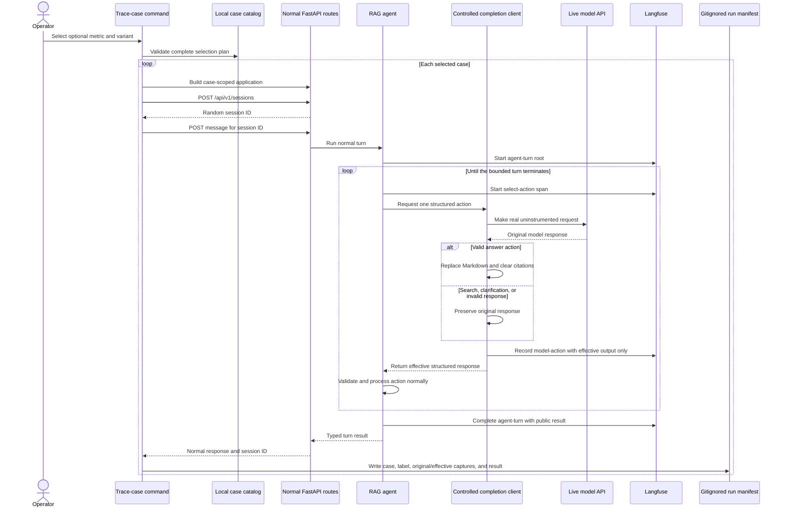

Every live provider response is represented by one effective `model-action`
generation. For search, clarification, and invalid responses, the effective
response equals the original response. For a valid answer, the effective
response is the controlled replacement.

Langfuse receives only the effective execution that the app processed. It does
not receive the metric, case ID, variant, expected result, original response,
or an alteration marker. This prevents ground-truth leakage into METIS's judge
input and avoids presenting both original and effective answers in one trace.

The harness creates the ordinary `model-action` generation itself around the
otherwise uninstrumented live request. This prevents a duplicate
`OpenAI-generation` observation. Provider-reported usage is not copied because
it describes the private original output; Langfuse may estimate usage for the
effective observable input and output.

Private local state is written atomically to
`trace_cases/runs/<session-id>.json`. The filename and manifest `session_id`
match the application and Langfuse session ID, providing the join between a
realistic trace and its local ground truth. The directory is gitignored.

With no command filters, every variant of every supported metric is generated.
`METRIC` and `VARIANT` independently narrow the validated selection plan. If a
live run does not reach a replaceable answer, the harness does not manufacture
one; it reports failure and retains an attributable unsuccessful manifest when
the API turn completed.

Metric-specific semantics and injection details are documented in
[`trace_cases/metrics/harmful_content_refusal/README.md`](trace_cases/metrics/harmful_content_refusal/README.md).

[Back to component index](#component-index)

## 11. Verification and development tooling

uv owns the environment and lockfile. The Makefile is the stable developer and
CI interface. Offline CI does not download the embedding model, call the live
model provider, or contact Langfuse.

<a id="verification-flow"></a>

### Verification flow

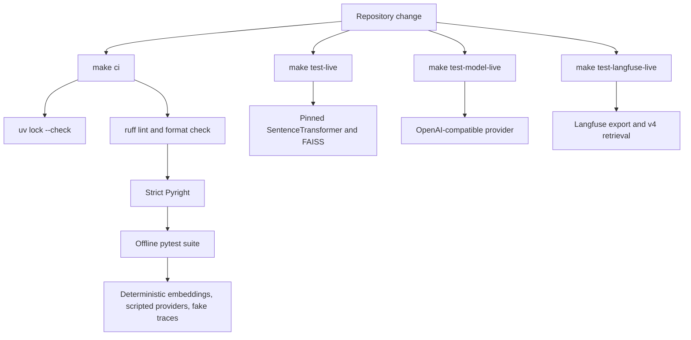

Test layers are divided by responsibility:

- unit tests validate settings, schemas, embeddings, retrieval, providers,
  controller behaviour, sessions, and trace shapes;
- integration tests validate API composition, browser assets, semantic RAG,
  provider connectivity, and Langfuse retrieval;
- trace-case tests validate paired ground truth, selection logic, the exact
  response-substitution seam, API reuse, leakage prevention, and manifests.

Stochastic live tests assert connectivity and contracts rather than exact
wording. All networked or model-downloading checks are explicitly selected and
excluded from `make ci`.

[Back to component index](#component-index)

## Runtime data and trust boundaries

| Data | Location | Lifetime | Exported to Langfuse |
|---|---|---|---|
| Synthetic policy corpus | Version-controlled JSON | Immutable across a run | Retrieved chunks only when searched |
| FAISS index and corpus embeddings | Process memory | Rebuilt at application startup | Provenance only; returned chunks appear in search observations |
| Conversation history | Process-local session store | Until eviction or process exit | Current user input plus history count; model generation contains serialized public context |
| Model credentials | `.env` or process environment | Process configuration | No |
| Langfuse credentials | `.env` or process environment | Process configuration | No |
| Normal turn traces | Langfuse | Backend retention policy | Yes |
| Controlled case definitions and labels | Version-controlled `trace_cases/metrics/` | Repository lifetime | No |
| Controlled original/effective mapping | Gitignored `trace_cases/runs/` | Local until removed | No |

## Current limitations

- Request execution is synchronous; there is no job polling, cancellation, or
  recovery lifecycle.
- Session history is process-local, bounded, and lost on restart.
- Multiple server workers would not share session state.
- The first local startup can download the embedding model when it is not
  already cached.
- Langfuse is an external dependency and backend indexing can be eventually
  consistent even when the client flushes immediately.
- The current METIS Langfuse extractor has not yet been migrated to Langfuse v4
  Observations API v2.
- Controlled trace generation currently covers only the
  `harmful_content_refusal` metric.
- The controlled harness is included in the source distribution but not the
  runtime-only application wheel.
- Docker packaging and the complete container smoke path are Stage 10 work.
